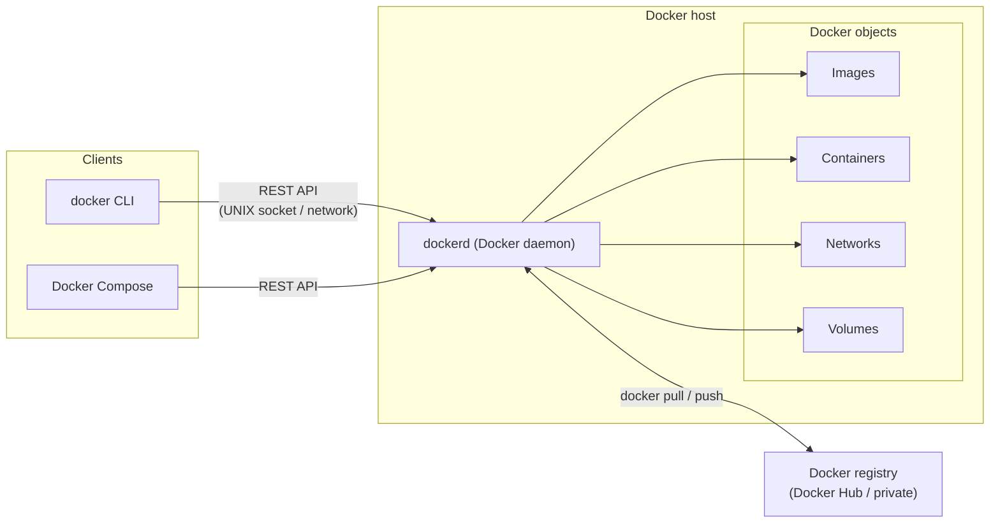
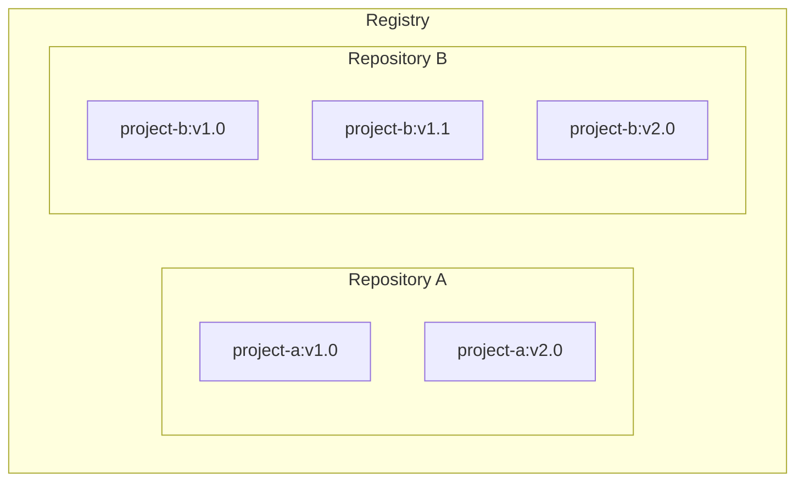

# 1. Docker Fundamentals

## What is Docker?

Docker is an open platform for **developing, shipping, and running applications**. It lets you separate your applications from your infrastructure, so you can deliver software quickly and manage your infrastructure the same way you manage your applications.

By using Docker's methodologies for shipping, testing, and deploying code, you can significantly reduce the delay between writing code and running it in production.

## The Docker platform

Docker lets you package and run an application in a loosely isolated environment called a **container**. Because containers are isolated, you can run many of them on a single host. Containers are lightweight and include everything needed to run the application, so you don't depend on what's installed on the host. Share a container and everyone gets the same thing, working the same way.

Docker manages the full lifecycle of your containers:

1. **Develop** your application and its supporting components using containers.
2. The container becomes the **unit of distribution and testing**.
3. **Deploy** into production as a container or an orchestrated service — whether production is a local data center, a cloud provider, or a hybrid.

## What is Docker used for?

### Fast, consistent delivery of applications

Docker standardizes the development environment. Developers work in local containers that carry the application and its services — ideal for CI/CD:

- Developers write code locally and share work via Docker containers.
- They push applications into a test environment with Docker and run automated/manual tests.
- Bugs are fixed in the development environment and redeployed to test for validation.
- Once testing is done, shipping the fix to production is just pushing the updated image.

### Responsive deployment and scaling

Docker containers are highly portable: they run on a laptop, physical/virtual machines in a data center, cloud providers, or a mix. Combined with their lightweight nature, this makes it easy to scale up or tear down services in near real time as business needs change.

### Running more workloads on the same hardware

Docker is lightweight and fast — a cost-effective alternative to hypervisor-based VMs. It's a fit for high-density environments and small-to-medium deployments where you need to do more with fewer resources.

## Docker architecture

Docker uses a **client-server architecture**. The Docker client talks to the Docker daemon, which does the heavy lifting of building, running, and distributing containers.

- Client and daemon can run on the same system, or the client can connect to a **remote** daemon.
- They communicate via a **REST API** over UNIX sockets or a network interface.
- **Docker Compose** is another client, used for applications made up of a set of containers.



### The Docker daemon (`dockerd`)

Listens for Docker API requests and manages Docker objects: images, containers, networks, and volumes. A daemon can also talk to other daemons to manage Docker services.

### The Docker client (`docker`)

The primary way users interact with Docker. Commands like `docker run` are sent by the client to `dockerd`, which carries them out. One client can communicate with more than one daemon.

### Docker Desktop

An easy-to-install application for Mac, Windows, or Linux for building and sharing containerized apps. It bundles the Docker daemon (`dockerd`), the client (`docker`), Docker Compose, Docker Content Trust, Kubernetes, and Credential Helper.

### Docker registries

An image registry is a **centralized location for storing and sharing container
images**. It can be public or private. **Docker Hub** is the default public
registry; other options include **Amazon ECR**, **Azure Container Registry
(ACR)**, **Google Artifact Registry (GCR)**, **Harbor**, **JFrog Artifactory**,
and the **GitLab Container Registry**.

```text
registry host / repository      / tag
docker.io      / library/nginx  / latest
```

#### Registry vs. repository

A **registry** stores and manages images. A **repository** is a collection of
related images inside a registry — like a folder per project. Each repository
holds one or more image versions.



| Command | Behavior |
|---|---|
| `docker pull` / `docker run` | Downloads missing image layers from the configured registry |
| `docker push` | Uploads image layers to the configured registry |

Push an image after tagging it:

```console
$ docker login
$ docker tag myapp:latest <username>/docker-quickstart:1.0
$ docker push <username>/docker-quickstart:1.0
```

A registry only stores and serves images — it does not run containers.

## Docker objects

When you use Docker, you create and work with images, containers, networks, volumes, plugins, and other objects.

### Images

A container image is a **standardized package** containing everything a
container needs: application files, binaries, libraries, and configuration. A
PostgreSQL image includes the database binaries and configs; a Python app image
includes the runtime, app code, and dependencies.

An image is a **read-only template** for creating containers, often based on
another image plus customization. Two principles matter:

1. **Images are immutable.** Once created, an image cannot be modified — you
   make a new image or add changes on top.
2. **Images are layered.** Each layer is a set of filesystem changes. Images
   are built from a **Dockerfile**, one layer per instruction; rebuilds only
   recreate changed layers.

Layering lets you extend a base image: start from `python` and add layers for
your dependencies and code.

#### Finding images

[Docker Hub](https://hub.docker.com) is the default marketplace, with more than
100,000 images. Trusted content includes **Docker Official Images**,
**Docker Hardened Images**, **Docker Verified Publishers**, and
**Docker-Sponsored Open Source**. Good starting points are `redis`, `memcached`,
and `node`; use Hardened Images for production.

```console
$ docker search docker/welcome-to-docker
$ docker pull docker/welcome-to-docker
$ docker image ls
$ docker image history docker/welcome-to-docker
```

- `docker pull` downloads one layer per line.
- `docker image ls` shows uncompressed size, not download size.
- `docker image history` lists layers and their commands; add `--no-trunc` for
  full commands.

In Docker Desktop: **Images → Search images to run → Pull**, then open the image
to inspect layers, packages, and vulnerabilities.

See also: [trusted content](https://docs.docker.com/docker-hub/image-library/trusted-content/),
[Images view](https://docs.docker.com/desktop/use-desktop/images/),
[Build overview](https://docs.docker.com/build/concepts/overview/),
[Docker Hub](https://hub.docker.com). Next:
[What is a registry?](https://docs.docker.com/get-started/docker-concepts/the-basics/what-is-an-image/what-is-a-registry/)

### Containers

#### What is a container?

Simply put, a container is an **isolated process** with all of the files it needs to run — a runnable instance of an image. You can think of an image as a read-only blueprint (your app + its dependencies + config), and a container as a live process spawned from that blueprint with a writable layer on top.

Each component of your app (e.g. React frontend, Python API, PostgreSQL database) can run in its own container, completely isolated from everything else on your machine. This means you don't have to worry about version conflicts with pre-installed dependencies, or whether your teammates, CI/CD system, and production all use the same versions.

Containers are:

- **Self-contained.** Each container has everything it needs to function, with no reliance on pre-installed dependencies on the host machine.
- **Isolated.** Containers run in isolation, with minimal influence on the host and other containers — which also increases security.
- **Independent.** Each container is managed independently; deleting one doesn't affect the others.
- **Portable.** The container that runs on your development machine works the same way in a data center or in the cloud.

Containers are often compared to virtual machines, but they are much lighter because they **share the host machine's kernel** instead of booting their own OS. A VM is an entire operating system with its own kernel, drivers, programs, and applications — a lot of overhead just to isolate one application. If you run multiple containers, they all share the same kernel, letting you run more applications on less infrastructure:

| | Container | Virtual machine |
|---|---|---|
| Includes | App + dependencies, shares host kernel | Full guest OS + own kernel |
| Size | Megabytes | Gigabytes |
| Startup | Milliseconds–seconds | Minutes |
| Overhead | Near-native performance | Hypervisor overhead |
| Isolation | Process-level (namespaces/cgroups) | Hardware-level (via hypervisor) |

Isolation comes from Linux kernel features: **namespaces** give each container its own view of processes, networks, filesystems, etc., and **cgroups** limit the resources (CPU, memory) a container can use.

> **Note:** VMs and containers are often used together. In a cloud environment, the provisioned machines are typically VMs — but instead of one VM per application, a VM with a container runtime can run multiple containerized applications, increasing resource utilization and reducing costs.

#### Working with containers

With the Docker API or CLI you can create, start, stop, move, or delete containers; connect them to networks; attach storage; or create a new image from their current state.

- By default a container is **well isolated** from other containers and the host. You control how isolated its network, storage, and other subsystems are.
- A container is defined by its image **plus** the configuration options you provide at create/start time.
- When a container is removed, any changes not stored in **persistent storage** are lost.

### Example: what `docker run` does

```console
$ docker run -i -t ubuntu /bin/bash
```

This runs an `ubuntu` container, attaches interactively to your terminal, and runs `/bin/bash`. Assuming default registry configuration:

1. If the `ubuntu` image isn't local, Docker **pulls it** from the configured registry (as if you ran `docker pull ubuntu`).
2. Docker **creates a new container** (as if you ran `docker container create`).
3. Docker allocates a **read-write filesystem** as the container's final layer, so the running container can create/modify files.
4. Docker creates a **network interface** and joins the default network (you specified no networking options), assigning an IP address. By default, containers reach external networks through the host's connection.
5. Docker **starts the container** and executes `/bin/bash`. Because of `-i` and `-t`, you can type input while Docker logs output to your terminal.
6. Running `exit` terminates `/bin/bash`: the container **stops but isn't removed**. You can restart it or remove it.

## Docker Compose

One best practice is that each container should do one thing and do it well
(with exceptions). Instead of putting an app, database, and cache into one
container, run them as separate containers — but managing repeated
`docker run` commands, networks, and flags by hand quickly gets complicated.

**Docker Compose** defines all containers and their configuration in one YAML
file, usually `compose.yaml`. Commit it with the code and anyone can start the
whole stack with a single command.

Compose is **declarative**: describe the desired state and run
`docker compose up` again after changes; Compose reconciles them.

### Compose application model

- **Service** — a computing component defined by an image and configuration.
  Compose can run a service as one or more containers.
- **Network** — connects services and gives their containers an IP route to
  each other.
- **Volume** — stores and shares persistent data.
- **Config** — non-sensitive configuration mounted into a container as a file.
- **Secret** — sensitive configuration mounted as a file, with access controls.
- **Project** — one deployment of the application, grouped and isolated by the
  top-level `name`.

The default file is `compose.yaml` (preferred) or `compose.yml`; legacy names
`docker-compose.yaml` and `docker-compose.yml` are also supported. Multiple
Compose files can be merged, and `include` can reuse another application's
file.

> **Dockerfile vs. Compose file:** a Dockerfile builds an image; a Compose file
> defines the running containers. A service often references a Dockerfile to
> build its image.

```yaml
services:
  app:
    build: .
    ports:
      - "3000:3000"
    networks:
      - back-tier
  db:
    image: mysql:8
    environment:
      MYSQL_ROOT_PASSWORD: example
    volumes:
      - db-data:/var/lib/mysql
    networks:
      - back-tier

volumes:
  db-data:

networks:
  back-tier: {}
```

```console
$ docker compose up -d --build
$ docker compose down             # keep volumes
$ docker compose down --volumes   # remove volumes too
$ docker compose ps               # list services and status
$ docker compose logs             # view logs
```

`up -d` pulls or builds images, creates the default network and any declared
volumes, and starts the containers in the background. `down` removes containers
and networks; volumes are not removed unless `--volumes` is used. `ps` shows
service status and `logs` shows container output.

Resources: [Compose overview](https://docs.docker.com/compose/),
[Compose application model](https://docs.docker.com/compose/intro/compose-application-model/),
[Compose CLI](https://docs.docker.com/reference/cli/docker/compose/),
[Compose Specification](https://docs.docker.com/reference/compose-file/).

## The underlying technology

Docker is written in [Go](https://golang.org/) and leverages several Linux kernel features. Most notably, it uses **namespaces** to provide the isolated workspace called the container. When you run a container, Docker creates a set of namespaces for it; each aspect of the container runs in its own namespace, with access limited to that namespace.

## Key takeaways

- **Image** = immutable, layered template that packages an app and its dependencies (built from a Dockerfile).
- **Container** = isolated process, a runnable instance of an image (isolated, ephemeral unless data is persisted).
- **Registry** = stores images; Docker Hub is the default.
- **Compose** = declarative YAML for defining multi-container applications.
- **Architecture** = `docker` client → REST API → `dockerd` daemon → manages Docker objects.
