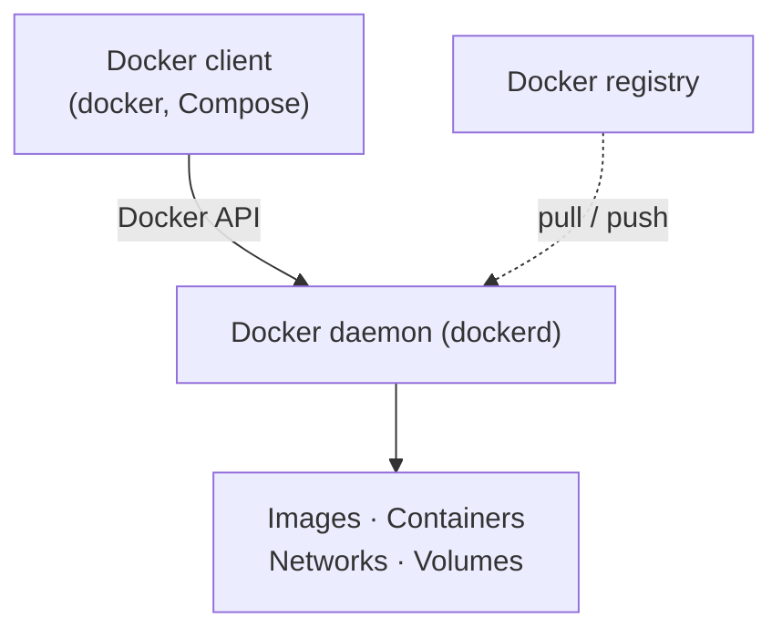

## 1.1 What is Docker

Docker is an open platform for developing, shipping, and running applications. It separates applications from infrastructure and packages each one in a loosely isolated environment called a **container** — lightweight, self-contained, and independent of what is installed on the host. Many containers can run on one host, and a shared container behaves the same for everyone.

Docker also manages the container lifecycle: develop with containers, use the container as the unit for distributing and testing, and deploy it as a container or orchestrated service in a data center, cloud, or hybrid environment.

**Why use it**

- **Consistent delivery** — standard environments for development and CI/CD, from local container to test to production image.
- **Responsive scaling** — portable across laptops, data centers, and clouds; scale up or tear down in near real time.
- **More workloads per host** — a lightweight alternative to hypervisor VMs, suited to high-density and small-to-medium deployments.

Docker is written in Go and uses Linux kernel **namespaces** to isolate each container's workspace.

## 1.2 Docker Architecture

Docker uses a client-server architecture. The client sends commands through the Docker API to the daemon (`dockerd`), which does the work of building, running, and managing Docker objects. Client and daemon can run on the same machine or on different ones.



**Components**

- **Docker client** — the interface for commands such as `docker run`, plus tools like Docker Compose.
- **Docker daemon (`dockerd`)** — the background service that manages images, containers, networks, and volumes.
- **Docker API** — how the client talks to the daemon, over a UNIX socket or a network interface.
- **Docker registry** — stores and distributes images; separate from the daemon, with Docker Hub as the public default.
- **Docker Desktop** — on Windows, bundles the tools and commonly uses its WSL 2 backend for Linux containers.

**Example**

```powershell
docker run -d --name my-nginx -p 8080:80 nginx
```

1. The CLI sends the request to the daemon.
2. The daemon looks for the image locally, pulling it from a registry if missing.
3. The daemon creates and starts the container and applies the port mapping.
4. The web server is reachable at <http://localhost:8080>.

The CLI requests; the daemon executes.

## 1.3 Images

An **image** is a read-only template with instructions for creating a container. Images are usually based on another image plus some customization — for example, an Ubuntu image with a web server and your application added.

**Layers.** An image is built from a Dockerfile, and each instruction creates a layer. Layers stack in order, each one representing only the changes applied to the previous layer. When you rebuild, only the layers that changed are rebuilt, which is part of why images are small and fast.

**Naming.** Images use the `name:tag` form, such as `nginx:1.27`. The tag selects a version; if you omit it, Docker assumes `latest`.

**Working with images**

```console
docker build -t myapp:1.0 .   # build from a Dockerfile in the current directory
docker pull nginx:1.27        # download an image from a registry
docker images                 # list local images
```

Images are stored in a registry (Docker Hub by default), pulled automatically by `docker run` or explicitly with `docker pull`, and uploaded with `docker push` — covered in 1.5.

## 1.4 Container

A **container** is a runnable instance of an image. You create, start, stop, move, and delete containers through the Docker CLI or API. It is defined by its image plus the configuration you pass when creating or starting it; you can also connect it to networks, attach storage, or build a new image from its current state.

By default a container is relatively well isolated from other containers and from the host, and you can control how isolated its network, storage, and other subsystems are. Containers are disposable: any changes not kept in persistent storage (such as a volume) disappear when the container is removed.

**Lifecycle**

```console
docker run -d --name web nginx   # create and start a container
docker ps                        # list running containers
docker stop web                  # stop it
docker start web                 # start it again
docker rm web                    # remove it
```

`docker ps -a` also shows stopped containers. An image is the template; a container is one running instance of it, and you can run many containers from the same image.

## 1.5 Registry

A **registry** stores and distributes Docker images. Docker Hub is the public registry anyone can use and the default Docker looks in; you can also run a private registry. When you `docker pull` or `docker run`, Docker downloads the required image from your configured registry if it is not available locally, and `docker push` uploads an image you built.

**Common commands**

```console
docker pull nginx:1.27                    # download an image
docker tag myapp:1.0 user/myapp:1.0        # name it for a registry
docker push user/myapp:1.0                # upload it
```

A full image reference can include the registry host, for example `ghcr.io/user/myapp:1.0`. Without a host, Docker uses Docker Hub.

## 1.6 Dockerfile, docker compose
Docker file is a text file containing instructions for building a Docker image. Docker compose is a tool for defining and running multi-container application using YAML
named compose.yaml

## 1.6.1 Dockerfile
description how to build an image step by step

```
# Use an official Node.js image as the base
FROM node:22-alpine

# Set the working directory
WORKDIR /app

# Copy dependency manifests
COPY package*.json ./

# Install dependencies
RUN npm install

# Copy application files
COPY . .

# Document the application's port
EXPOSE 3000

# Start the application
CMD ["npm", "start"]
```

## Common instructions
* ``FROM`` - specifies the base image
* ``WORKDIR`` - sets the working directory inside the image
* ``COPY`` - copies files from the build context into the image
* ``RUN`` - executes commands during image building
