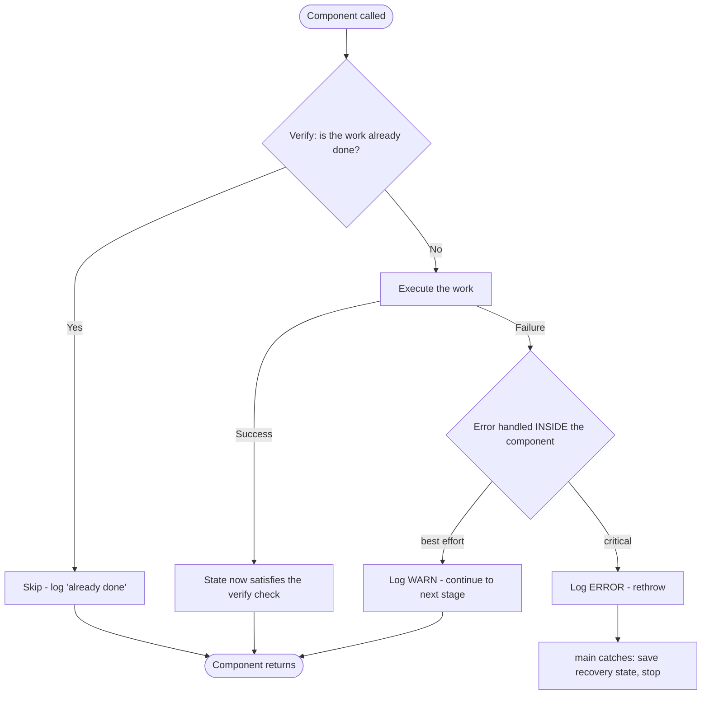
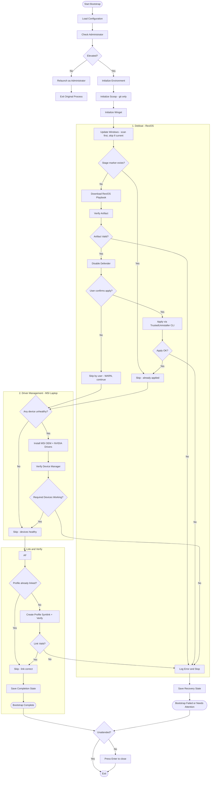

# Windows bootstrap architecture

Every stage component in `bootstrap.ps1` follows the same contract:

- **Verify first** — each component checks its own end state (marker file,
  package actually installed, device status, symlink target, update scan…).
  Already done → log and return without touching anything.
- **Error handling inside** — each component wraps its work in `try/catch`
  itself. Best-effort components (updates, drivers) log a `WARN` and let the
  bootstrap continue; critical components (scoop init, winget init, debloat
  apply, profile link) log `ERROR` and rethrow so `main` can save the
  recovery state and stop.
- `main`'s outer `try/catch` is only a last resort; its `finally` block pauses
  with "Press Enter to close" on both success and failure (skipped with
  `-Unattended`), so the elevated RunAs window does not vanish instantly.

| Stage | Verify check | Skip means | Error policy |
| --- | --- | --- | --- |
| `Initialize-Environment` | CurrentUser execution policy already `RemoteSigned`; directories exist | nothing to set | WARN, continue |
| `Initialize-Scoop` | `scoop` on PATH; `main` bucket present; `git` installed | scoop ready, git installed | rethrow (needed downstream) |
| `Initialize-Winget` | `winget` on PATH; sources refreshed | winget ready | rethrow (needed by `install-software.ps1`) |
| `Update-Windows` | update scan returns 0 pending updates | up to date, no reboot | WARN, continue |
| `Invoke-Debloat` | stage marker `stage-debloat.done` in state dir | playbook already applied | rethrow |
| `Invoke-Drivers` | no present device with `Status != OK/Unknown` | all devices healthy | rethrow only on user decline; else WARN |
| `Complete-Bootstrap` | live `$PROFILE` is a symlink into this repo | link already correct | rethrow |

Stage markers are one-shot files (`<StateDir>\stage-<name>.done`); delete the
marker to force that stage to run again.

Software installation is **not** part of bootstrap. Bootstrap only initializes
the tooling (scoop with git, winget); the actual packages and installers live
in `install-software.ps1`, run separately afterwards.

## Flow

## Files

| File | Role |
| --- | --- |
| `bootstrap.ps1` | Stage components + `main` orchestration (init, debloat, drivers, profile link) |
| `install-software.ps1` | Scoop/winget packages + external installers; run separately after bootstrap |
| `ame-cli.ps1` | `Invoke-ReviCli` — headless ReviOS apply via TrustedUninstaller CLI |
| `tests/` | Pester tests — `Bootstrap.Tests.ps1` (all bootstrap stages incl. debloat), `InstallSoftware.Tests.ps1` (software install + state file). Run with `Invoke-Pester .\tests` |
| `specs/` | Plan documents for pending/completed changes |

## Software installation

`install-software.ps1` follows the same verify-first contract as the bootstrap
stages but runs standalone, as a normal user (no elevation):

| Component | Verify check | Skip means | Error policy |
| --- | --- | --- | --- |
| `Install-ScoopPackages` | `scoop list <pkg>` lists the package | package installed | WARN per package |
| `Install-WingetPackages` | `winget list --id` finds the package | package installed | WARN per package |
| `Install-Software` | `git`/`fzf`/`zed`/`code` all on PATH | software present | rethrow |

`main` bails out early when scoop or winget is missing — run `bootstrap.ps1`
first.

Every managed package — scoop, winget and external installers — is recorded
(`installed`, `already-present` or `failed`, with tool and timestamp) to
`~\.dotfiles\software.state.json`. The file is rewritten on each run and
always holds the full inventory; a summary is printed at the end.
