# Windows bootstrap architecture

Every stage component in `bootstrap.ps1` follows the same contract:

- **Verify first** — each component checks its own end state (marker file,
  package actually installed, device status, symlink target, update scan…).
  Already done → log and return without touching anything.
- **Self-repair where cheap** — `Initialize-Winget` does not fail outright
  when `winget` is missing: the stage downloads the latest winget-cli
  `.msixbundle` with its dependency packages (a zip on recent releases,
  standalone `.appx` on older ones) and installs it. Only when that fails
  does the stage rethrow.
- **Interactive prerequisites** — when a step needs a human (Tamper
  Protection, the four Windows Security toggles), the stage names the
  toggle that is still on, opens Windows Security, waits for confirmation
  and re-checks before continuing. The ReviOS CLI is never started while a
  toggle is on, so it cannot hang on its own "press any key" loop.
- **Error handling inside** — each component wraps its work in `try/catch`
  itself. Best-effort components (updates, drivers) log a `WARN` and let the
  bootstrap continue; critical components (scoop init, winget init, debloat
  apply, profile link) log `ERROR` and rethrow so `main` can save the
  recovery state and stop.
- **Scan, install, repeat until clean** — `Invoke-WindowsUpdates` scans
  through the built-in Windows Update client API
  (`Microsoft.Update.Session`), prints the pending updates and installs
  exactly that set; it scans again and repeats until a scan comes back with
  no pending update package left. The loop ends for three reasons only: no
  package left (done), a reboot is pending (the rest is picked up after the
  reboot) or a round installed nothing (the round cap ends it too).
  `-SkipUpdateCheck` skips the stage.
  There is no concurrency knob: the Windows Update service already fetches
  content over several connections on its own, while installs have to stay
  serial because CBS/TrustedInstaller takes an exclusive servicing lock
  (`0x80240016` / `1618` otherwise).
- `main`'s outer `try/catch` is only a last resort; its `finally` block pauses
  with "Press Enter to close" on both success and failure (skipped with
  `-Unattended`), so the elevated RunAs window does not vanish instantly.

| Stage | Verify check | Skip means | Error policy |
| --- | --- | --- | --- |
| `Invoke-WindowsUpdates` | scan returns 0 pending update packages (the loop installs what it finds; `-SkipUpdateCheck` skips the stage) | Windows is up to date | WARN, continue — a failed scan or install logs and continues |
| `Initialize-Environment` | CurrentUser execution policy already `RemoteSigned`; directories exist | nothing to set | WARN, continue |
| `Initialize-Scoop` | `scoop` on PATH; `main` bucket present; `git` installed | scoop ready, git installed | rethrow (needed downstream) |
| `Initialize-Winget` | `winget` on PATH; sources refreshed | winget ready | missing → repair (GitHub msixbundle download); still missing → rethrow (needed by `install-software.ps1`) |
| `Invoke-Debloat` | stage marker `stage-debloat.done` in state dir; all four Windows Security toggles off | playbook already applied | rethrow; also blocks before the CLI when a toggle stays on (`Invoke-DefenderCheck` hands the toggles to the user first) |
| `Invoke-Drivers` | no present device with `Status != OK/Unknown` | all devices healthy | rethrow only on user decline; else WARN |
| `Complete-Bootstrap` | live `$PROFILE` is a symlink into this repo | link already correct | rethrow |

Stage markers are one-shot files (`<StateDir>\stage-<name>.done`); delete the
marker to force that stage to run again.

## The bootstrap file

`bootstrap.ps1` is read top-down in numbered sections: 1 configuration,
2 support, 3 environment, 4 scoop, 5 winget, 6 Windows Update, 7 Windows
Defender, 8 debloat, 9 drivers, 10 profile, 11 the entry point.

The rule that keeps the file small: **a helper may stay only when it
supports the core (a shared utility) or is a structural part of a core** (the
core split into its natural steps). Everything else folds into its caller.

- **Support** (section 2): `Confirm-Step`, `Write-StateFile`,
  `Update-SessionPath`, `Release-Com` — plus the download wrapper
  (`Get-RemoteFile`) and the artifact check (`Test-Artifact`) in
  `lib/common.ps1`.
- **Structure of a core**: `Search-WindowsUpdates` → `Get-UpdateSummary` →
  `Install-WindowsUpdates` → `Test-RebootRequired` (the update core: scan the
  packages, report them, install them or not, repeat), `Test-WingetAvailable`
  → `Install-WingetFromRelease`, `Get-DefenderTogglesOn` →
  `Invoke-DefenderCheck`, `Get-UnhealthyDevices` → `Invoke-Drivers`,
  `Test-ProfileLinked` → `Complete-Bootstrap`.

Software installation is **not** part of bootstrap. Bootstrap only initializes
the tooling (scoop with git, winget); the actual packages and installers live
in `install-software.ps1`, run separately afterwards.

## Flow

```mermaid
flowchart TD
    A([Start Bootstrap]) --> B[Load Configuration]
    B --> C[Check Administrator]
    C --> D{Elevated?}

    D -- No --> E[Relaunch as Administrator]
    E --> F[Exit Original Process]
    D -- Yes --> I[Test Windows Updates - scan, install, repeat]
    I --> IU{Pending updates?}

    IU -- No --> G[Initialize Environment]
    IU -- Yes --> II[Report them - confirm]
    II --> II2[Install the scanned set]
    II2 --> II3{Reboot pending?}
    II3 -- Yes --> II4[Stop - the rest is installed after the reboot]
    II3 -- No --> I
    II4 --> G

    G --> H[Initialize Scoop - git only]
    H --> H2[Initialize Winget]
    H2 --> HW{winget on PATH?}
    HW -- No --> HR[Repair App Installer - GitHub msixbundle download]
    HR --> HW2{winget available now?}
    HW2 -- No --> WERR[Log Error - rethrow]
    HW2 -- Yes --> HS
    HW -- Yes --> HS[Refresh winget sources]
    HS --> DJ

    subgraph DEBLOAT["1. Debloat - ReviOS"]
        DJ{Stage marker exists?}
        DJ -- Yes --> DJX[Skip - already applied]
        DJ -- No --> M[Check Windows Defender]
        M --> MD{All 4 Windows Security toggles off?}
        MD -- Yes --> P{User confirms apply?}
        MD -- No --> MP[Open Windows Security - user turns the toggles off - press Enter - re-check]
        MP --> MC{Still on?}
        MC -- No --> P
        MC -- Yes --> ERR
        P -- No --> DJQ[Skip by user - WARN, continue]
        P -- Yes --> O[Apply via TrustedUninstaller CLI - downloads and verifies the playbook]
        O --> Q{Apply OK?}
        Q -- No --> ERR[Log Error and Stop]
        Q -- Yes --> DJX
    end

    DJQ --> R

    DJX --> R{Any device unhealthy?}

    subgraph DRIVERS["2. Driver Management - MSI Laptop"]
        R -- No --> RX[Skip - devices healthy]
        R -- Yes --> S[Install MSI OEM + NVIDIA Drivers]
        S --> X[Verify Device Manager]
        X --> Y{Required Devices Working?}
        Y -- No --> ERR
        Y -- Yes --> RX
    end

    RX --> AF

    subgraph FINAL["3. Link and Verify"]
        AF --> AG{Profile already linked?}
        AG -- Yes --> AGX[Skip - link correct]
        AG -- No --> AH[Create Profile Symlink + Verify]
        AH --> AI{Link Valid?}
        AI -- No --> ERR
        AI -- Yes --> AGX
        AGX --> AJ[Save Completion State]
        AJ --> AK([Bootstrap Complete])
    end

    ERR --> AL[Save Recovery State]
    WERR --> AL
    AL --> AM([Bootstrap Failed or Needs Attention])

    AK --> PAUSE{Unattended?}
    AM --> PAUSE
    PAUSE -- No --> WAIT[Press Enter to close]
    PAUSE -- Yes --> WAITX([Exit])
    WAIT --> WAITX
```

## Files

| File | Role |
| --- | --- |
| `bootstrap.ps1` | The stages + `main` orchestration (init, updates, debloat, drivers, profile link). Section 2 holds the shared helpers, every other section is one stage |
| `lib/common.ps1` | Shared helpers (`Get-RemoteFile`, `Test-Artifact`) — dot-sourced by `bootstrap.ps1`, `install-software.ps1` and `ame-cli.ps1` |
| `install-software.ps1` | Scoop/winget packages + external installers; run separately after bootstrap |
| `ame-cli.ps1` | `Invoke-ReviCli` — headless ReviOS apply via TrustedUninstaller CLI |
| `tests/` | Pester tests — `Bootstrap.Tests.ps1` (all bootstrap stages incl. debloat), `Defender.Tests.ps1` (Defender helpers), `InstallSoftware.Tests.ps1` (software install + state file). Run with `Invoke-Pester .\tests` |
| `specs/` | Plan documents for pending/completed changes (`specs/plans/merge-update-into-bootstrap.md` documents the update stage, `specs/plans/simple-defender-check.md` the Defender check, `specs/plans/simplify-bootstrap-helpers.md` the helper cleanup, `specs/plans/simplify-bootstrap-code.md` the core/support split) |

## Windows Defender

`bootstrap.ps1` owns everything Defender related: the debloat stage calls
`Invoke-DefenderCheck` before the playbook runs, because the playbook refuses
to apply while Defender is on.

Turning them off is deliberately **manual** — the stage never writes to the
platform:

1. **Verify** — `Get-DefenderTogglesOn` reads the four Windows Security
   toggles the ReviOS playbook checks (real-time, cloud-delivered, sample
   submission, Tamper Protection). All off → nothing to do. The preferences
   behind them are the ones the UI itself writes: real-time =
   `Get-MpComputerStatus.RealTimeProtectionEnabled`, cloud-delivered =
   `MAPSReporting` (0 = off), sample submission = `SubmitSamplesConsent`
   (0 = never send), Tamper Protection = `DisableTamperProtection` with the
   registry value as the fallback. "Block at first sight"
   (`DisableBlockAtFirstSeen`) is deliberately **not** read: it is a hidden
   preference, not a toggle of the UI, and it keeps its default when the
   user switches the real toggle off — reading it blocked the stage
   forever. A Tamper Protection value that cannot be read at all counts as
   **on**: unknown must not open the gate to a protected machine.
2. **Hand over** — print what is still on, open Windows Security and wait
   for the user to press Enter. One round, no loop: the user drives the
   toggles, the stage only checks the result.
3. **Verify again** — `Invoke-DefenderCheck` returns the result; the debloat
   stage throws when a toggle is still on, so the TrustedUninstaller CLI
   never runs against a protected machine. With `-Unattended` the stage
   reports only: no window is opened and nobody is waited for, so the
   toggles stay as they are and the debloat is blocked.

There is no `Set-MpPreference` call and no policy key behind steps 2–3.
Tamper Protection refuses every scripted change (`Set-MpPreference` answers
`0x80004001`, the registry write answers "access not allowed") and releasing
it programmatically never worked on a protected machine, so the scripted
routes were removed rather than kept as dead weight. Windows Security is the
single place where the toggles change: **Tamper protection** first, then the
rest.

## Windows Update

`Invoke-WindowsUpdates` scans, installs and repeats until Windows has no
pending update package left. The stage is the merge of the old standalone
`update.ps1` into the bootstrap: the elevation, the reporting and the state
handling already lived here, the install came with it.

It is the first stage that does work — it runs right after the elevation, so
the machine is patched before scoop, winget, the debloat and the drivers
touch it.

1. **Scan** — `Search-WindowsUpdates` asks the built-in Windows Update
   client API (`Microsoft.Update.Session`, criteria
   `IsInstalled=0 and IsHidden=0`) for pending updates and keeps the update
   objects alive, so one scan feeds both the report and the install. The
   search targets Microsoft Update explicitly (`ServerSelection = 2` plus
   the Microsoft Update service id), so a machine that points at a managed
   server is not silently held back by the policy of that server. A failed
   scan logs a warning and ends the stage.
2. **Report and confirm** — `Get-UpdateSummary` turns every update into a
   summary (title, size in MB, KB) and the stage prints the complete pending
   list *before* anything is installed. `Confirm-Step` asks
   once per round (`-Unattended` auto-confirms); a declined install opens
   `ms-settings:windowsupdate` and leaves the updates to Windows.
3. **Install** — `Install-WindowsUpdates` fetches the payload and installs
   it through the same client API (`CreateUpdateDownloader()` →
   `Download()`, `CreateUpdateInstaller()` → `Install()`), then reports every
   update with its result code and HRESULT. Installs stay serial:
   CBS/TrustedInstaller holds an exclusive servicing lock.
4. **Repeat** — the stage scans again. It ends when a scan comes back
   empty, when a reboot is pending (`Test-RebootRequired`: the installer's
   flag, CBS `RebootPending`, the Windows Update `RebootRequired` value and
   pending file renames — the same packages would show up in the next scan)
   or when a round installed nothing. `$Config.UpdateMaxRounds` (5) caps the
   loop. **The stage never reboots the machine** — the remaining updates are
   installed by the next bootstrap run, after the reboot.

The result is recorded as the `windowsUpdate` block (`upToDate`,
`pendingCount`, `pendingSizeMb`, `rounds`, `installed`, `failed`,
`rebootRequired`, `skipped`, `checkedAt`) in `bootstrap.state.json`;
`-SkipUpdateCheck` skips the stage and writes `"skipped": true`. The block
holds the keys that are read — the per-update detail is not stored.

There is no concurrency knob: the Windows Update service fetches content
over several connections on its own, and the install pass is serial by
definition.

## Software installation

`install-software.ps1` follows the same verify-first contract as the bootstrap
stages but runs standalone, as a normal user (no elevation). The package ids
live in `package.txt` (`<tool> <id>` per line, `#` for comments).

| Component | Verify check | Skip means | Error policy |
| --- | --- | --- | --- |
| `Install-ScoopPackages` | `scoop prefix <pkg>` succeeds | package installed | WARN per package |
| `Install-WingetPackages` | `winget list --id` finds the package | package installed | WARN per package |
| `Install-Software` | `git`/`fzf`/`zed`/`code` all on PATH | software present | rethrow |

`main` bails out early when scoop or winget is missing — run `bootstrap.ps1`
first.

Every managed package — scoop, winget and external installers — is recorded
(`installed`, `already-present` or `failed`, with tool and timestamp) to
`~\.dotfiles\software.state.json`. The file is rewritten on each run and
always holds the full inventory; a summary is printed at the end.
