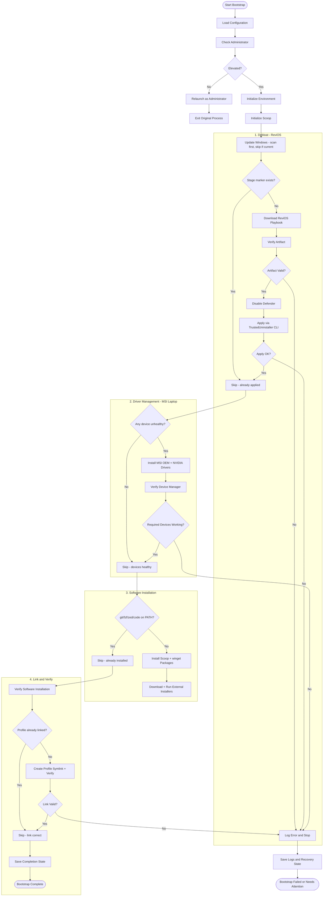

# Windows bootstrap architecture

Every stage component in `bootstrap.ps1` follows the same contract:

- **Verify first** — each component checks its own end state (marker file,
  package actually installed, device status, symlink target, update scan…).
  Already done → log and return without touching anything.
- **Error handling inside** — each component wraps its work in `try/catch`
  itself. Best-effort components (updates, scoop packages, winget packages,
  drivers) log a `WARN` and let the bootstrap continue; critical components
  (debloat apply, profile link) log `ERROR` and rethrow so `main` can save
  the recovery state and stop.
- `main`'s outer `try/catch` is only a last resort.

| Stage | Verify check | Skip means | Error policy |
| --- | --- | --- | --- |
| `Initialize-Environment` | CurrentUser execution policy already `RemoteSigned`; directories exist | nothing to set | WARN, continue |
| `Initialize-Scoop` | `scoop` on PATH; `main` bucket present | scoop ready | rethrow (needed downstream) |
| `Update-Windows` | update scan returns 0 pending updates | up to date, no reboot | WARN, continue |
| `Invoke-Debloat` | stage marker `stage-debloat.done` in state dir | playbook already applied | rethrow |
| `Invoke-Drivers` | no present device with `Status != OK/Unknown` | all devices healthy | rethrow only on user decline; else WARN |
| `Install-ScoopPackages` | `apps\<pkg>\current` exists (user or ProgramData scoop) | package installed | WARN per package |
| `Install-WingetPackages` | `winget list --id` finds the package | package installed | WARN per package |
| `Install-Software` | `git`/`fzf`/`zed`/`code` all on PATH | software present | rethrow |
| `Complete-Bootstrap` | profile is a symlink into this repo | link already correct | rethrow |

Stage markers are one-shot files (`<StateDir>\stage-<name>.done`); delete the
marker to force that stage to run again.

## Flow

## Files

| File | Role |
| --- | --- |
| `bootstrap.ps1` | Stage components + `main` orchestration |
| `ame-cli.ps1` | `Invoke-ReviCli` — headless ReviOS apply via TrustedUninstaller CLI |
| `Debloat.Tests.ps1` | Pester tests for the debloat flow |
| `DEBLOAT.md` | Debloat stage details (CLI, option ids, techniques) |
