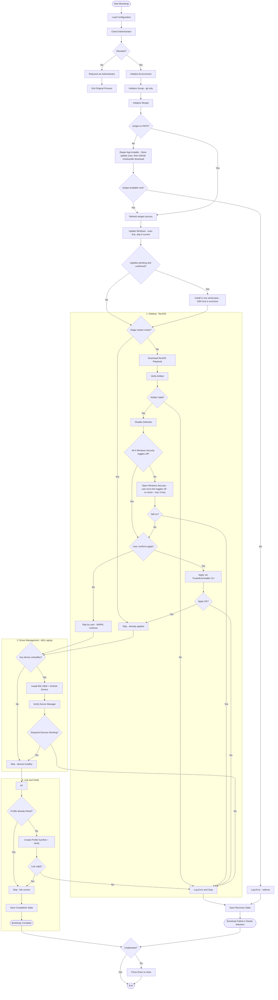

# Windows bootstrap architecture

Every stage component in `bootstrap.ps1` follows the same contract:

- **Verify first** — each component checks its own end state (marker file,
  package actually installed, device status, symlink target, update scan…).
  Already done → log and return without touching anything.
- **Self-repair where cheap** — `Initialize-Winget` does not fail outright
  when `winget` is missing: `Repair-Winget` first asks the Microsoft Store
  to run an update scan (App Installer arrives from the Store), then falls
  back to downloading and installing the latest winget-cli `.msixbundle`
  with its dependency packages (a zip on recent releases, standalone
  `.appx` on older ones). Only when both routes fail does the stage
  rethrow.
- **Interactive prerequisites** — when a step needs a human (Tamper
  Protection, the four Windows Security toggles), the stage names the
  toggle that is still on, opens Windows Security, waits for confirmation
  and re-checks before continuing. The ReviOS CLI is never started while a
  toggle is on, so it cannot hang on its own "press any key" loop.
- **Error handling inside** — each component wraps its work in `try/catch`
  itself. Best-effort components (updates, drivers) log a `WARN` and let the
  bootstrap continue; critical components (scoop init, winget init, debloat
  apply, profile link) log `ERROR` and rethrow so `main` can save the
  recovery state and stop.
- **One scan, one install** — `Update-Windows` scans once with
  `PSWindowsUpdate`, prints the pending updates and asks before touching
  anything. After the confirmation a single `Get-WindowsUpdate -Install`
  pass downloads and installs the pending content. There is no separate
  download phase and no concurrency knob: the Windows Update service
  already fetches content over several connections on its own, while
  installs have to stay serial because CBS/TrustedInstaller takes an
  exclusive servicing lock (`0x80240016` / `1618` otherwise).
- `main`'s outer `try/catch` is only a last resort; its `finally` block pauses
  with "Press Enter to close" on both success and failure (skipped with
  `-Unattended`), so the elevated RunAs window does not vanish instantly.

| Stage | Verify check | Skip means | Error policy |
| --- | --- | --- | --- |
| `Initialize-Environment` | CurrentUser execution policy already `RemoteSigned`; directories exist | nothing to set | WARN, continue |
| `Initialize-Scoop` | `scoop` on PATH; `main` bucket present; `git` installed | scoop ready, git installed | rethrow (needed downstream) |
| `Initialize-Winget` | `winget` on PATH; sources refreshed | winget ready | missing → `Repair-Winget` (Store update scan, then GitHub msixbundle download); still missing → rethrow (needed by `install-software.ps1`) |
| `Update-Windows` | update scan returns 0 pending updates (NuGet provider and PSGallery trust prepared non-interactively) | up to date, no reboot | WARN, continue |
| `Invoke-Debloat` | stage marker `stage-debloat.done` in state dir; all four Windows Security toggles off | playbook already applied | rethrow; also blocks before the CLI when a toggle stays on (the Defender stage hands the remaining toggles to the user first) |
| `Invoke-Drivers` | no present device with `Status != OK/Unknown` | all devices healthy | rethrow only on user decline; else WARN |
| `Complete-Bootstrap` | live `$PROFILE` is a symlink into this repo | link already correct | rethrow |

Stage markers are one-shot files (`<StateDir>\stage-<name>.done`); delete the
marker to force that stage to run again.

Software installation is **not** part of bootstrap. Bootstrap only initializes
the tooling (scoop with git, winget); the actual packages and installers live
in `install-software.ps1`, run separately afterwards.

## Flow

## Files

| File | Role |
| --- | --- |
| `bootstrap.ps1` | Stage components + `main` orchestration (init, debloat, drivers, profile link) |
| `install-software.ps1` | Scoop/winget packages + external installers; run separately after bootstrap |
| `ame-cli.ps1` | `Invoke-ReviCli` — headless ReviOS apply via TrustedUninstaller CLI |
| `tests/` | Pester tests — `Bootstrap.Tests.ps1` (all bootstrap stages incl. debloat), `Defender.Tests.ps1` (Defender helpers), `InstallSoftware.Tests.ps1` (software install + state file). Run with `Invoke-Pester .\tests` |
| `specs/` | Plan documents for pending/completed changes |

## Windows Defender

`bootstrap.ps1` owns everything Defender related: the debloat stage calls
`Disable-Defender` + `Resolve-DefenderManually` before the playbook runs,
because the playbook refuses to apply while Defender is on.

The flow is:

1. **Verify** — read the four Windows Security toggles the ReviOS playbook
   checks (real-time, cloud-delivered, sample submission, Tamper
   Protection). All off → nothing to do.
2. **Scripted** — `Set-MpPreference` turns off real-time, behavior/IOAV,
   cloud-delivered (block at first sight + MAPS) and sample submission; the
   `DisableAntiSpyware` and real-time policy keys keep them off.
3. **By hand** — Tamper Protection locks real-time protection: both
   programmatic routes fail (`Set-MpPreference -DisableTamperProtection`
   answers `0x80004001`, the registry write answers "access not allowed").
   The stage opens Windows Security, waits and re-checks (max 3 rounds).
4. **Verify again** — the debloat stage throws when a toggle is still on, so
   the TrustedUninstaller CLI never runs against a protected machine.

## Windows Update

`Update-Windows` is deliberately the smallest stage in the bootstrap:

1. **Prepare** — install the NuGet package provider, trust PSGallery and make
   sure `PSWindowsUpdate` is present, so no prompt can stop the run.
2. **Scan** — one `Get-WindowsUpdate` call. No pending updates means the
   stage returns right away and no reboot is needed.
3. **Report** — print the pending updates with their size
   (`Format-UpdateSize` normalizes the `44MB` / byte-count shapes that
   PSWindowsUpdate reports).
4. **Confirm** — installing means a reboot later, so the user decides.
5. **Install** — a single `Get-WindowsUpdate -Install -AcceptAll
   -IgnoreReboot` pass downloads and installs the pending updates.

There is no separate download phase. The Windows Update service already
fetches content over several connections on its own, and installs must stay
serial: CBS/TrustedInstaller holds an exclusive servicing lock, so concurrent
installs only produce `0x80240016` / `1618`. The stage is best effort — a
failure is logged and the bootstrap continues.

## Software installation

`install-software.ps1` follows the same verify-first contract as the bootstrap
stages but runs standalone, as a normal user (no elevation):

| Component | Verify check | Skip means | Error policy |
| --- | --- | --- | --- |
| `Install-ScoopPackages` | `scoop list <pkg>` lists the package | package installed | WARN per package |
| `Install-WingetPackages` | `winget list --id` finds the package | package installed | WARN per package |
| `Install-Software` | `git`/`fzf`/`zed`/`code` all on PATH | software present | rethrow |

`main` bails out early when scoop or winget is missing — run `bootstrap.ps1`
first.

Every managed package — scoop, winget and external installers — is recorded
(`installed`, `already-present` or `failed`, with tool and timestamp) to
`~\.dotfiles\software.state.json`. The file is rewritten on each run and
always holds the full inventory; a summary is printed at the end.
